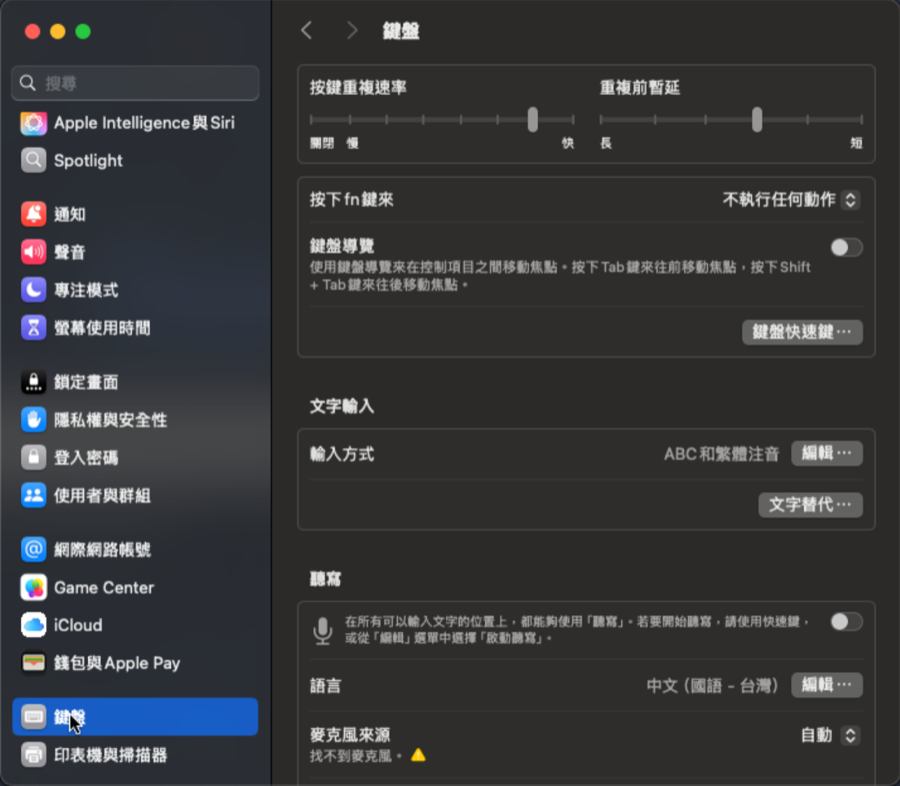
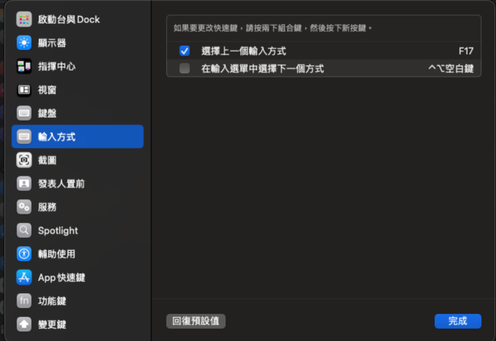

# ScreenInputSync

安裝在**發起連線那台 Mac** 上的選單列小工具。在 Apple 螢幕共享（Screen Sharing）裡按 Caps Lock，本機與遠端會一起在 ABC／繁體注音之間切換，而且打字行為與遠端顯示的輸入法一致。其他 App 的 Caps Lock 不受影響。

## 為什麼本機也要跟著切換

螢幕共享會先用**本機**的輸入法轉換按鍵，再把結果送到遠端，所以兩邊必須一致（2026-11-03 實測）：

| 本機 | 遠端 | 打字結果 |
|---|---|---|
| 注音 | 注音 | 正常組字 |
| ABC | 注音 | 直接出英文，無法組字 |
| ABC | ABC | 正常半形英文 |
| 注音 | ABC | 小寫字母變成注音符號 |

## 運作方式

在螢幕共享位於前景時：

- **Caps Lock**：本機明確切換輸入法，並送出 F17 讓遠端切換。Caps Lock 鍵與大寫鎖定狀態都不會傳到遠端（否則遠端注音會被切成英文模式）。
- **本機跟隨遠端**：本機輸入法一律維持與遠端相同。例如在其他 App 切過輸入法再回到螢幕共享，本機會自動切回遠端的輸入法；離開螢幕共享後則恢復你原本使用的輸入法。
- **對齊遠端輸入法**：同時按下 ⌘ 和 ⇧ 再放開（中間不按其他鍵），或從選單選「對齊遠端輸入法」，然後依遠端選單列按 `E`（ABC）或 `C`（注音），`Esc` 取消。只改本機，不送 F17。選單與快捷鍵都只在螢幕共享位於前景時有效：從選單點選會提示先切過去，快捷鍵在其他 App 則不作用（`⌘⇧P` 等一般快捷鍵也不受影響）。

本機無法讀取遠端的實際輸入法，只能依 Caps Lock 次數推算。若兩邊變得相反（例如遠端被用滑鼠單獨切換，或 App 剛啟動時推算錯誤），用「對齊遠端輸入法」校正即可。

## 系統需求

- macOS 14 或更新版本
- 本機已啟用 ABC 與「繁體中文－注音」
- 遠端完成下方「遠端 Mac 設定」
- 編譯需要 **Xcode 16 或更新版本**（專案使用 Swift 6）

## 遠端 Mac 設定

遠端（被連線的那台）不需要安裝任何東西，只要在「系統設定 → 鍵盤」設定兩件事：

1. **輸入方式只保留 ABC 與繁體注音**：按「輸入方式」旁的「編輯…」，移除其他輸入方式，確保切換只在這兩者之間來回。

   

2. **把 F17 設為「選擇上一個輸入方式」**：按「鍵盤快速鍵…」→ 左側選「輸入方式」→ 勾選「選擇上一個輸入方式」，點兩下右側的快捷鍵後按 F17。若鍵盤沒有 F17，可在本機裝好 ScreenInputSync 後，透過螢幕共享在該欄位按一次 Caps Lock，工具送出的 F17 就會被錄進去（已實測）。錄製時本機輸入法會跟著切換一次，但遠端不會，若之後兩邊相反，用 ⌘⇧ 對齊即可。

   

## 權限

只需要「系統設定 → 隱私權與安全性 → **輔助使用**」（攔截／修改按鍵與送出 F17 都靠它），不需要「輸入監控」。允許後重新開啟 App；選單中也有「開啟輔助使用權限設定」可直接前往。

編譯前請在 Xcode 的 Signing & Capabilities 選擇自己的 Team。專案預設是 ad-hoc 簽署（Sign to Run Locally），每次重新編譯都會被系統當成新 App，必須重新允許權限。

若權限顯示已允許卻仍被要求（簽署身分變更後常見），清除舊紀錄後重新允許：

```sh
tccutil reset Accessibility com.brant.ScreenInputSync
```

## 解除安裝

從選單取消「登入時啟動」並結束 App，然後：

```sh
rm -rf /Applications/ScreenInputSync.app
```

最後可在系統設定中移除它的輔助使用權限。
