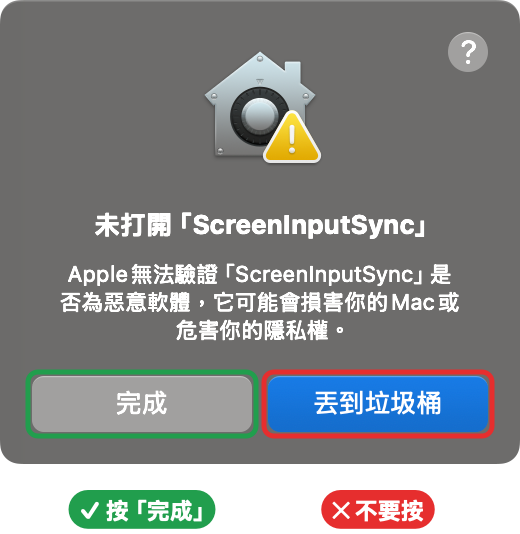
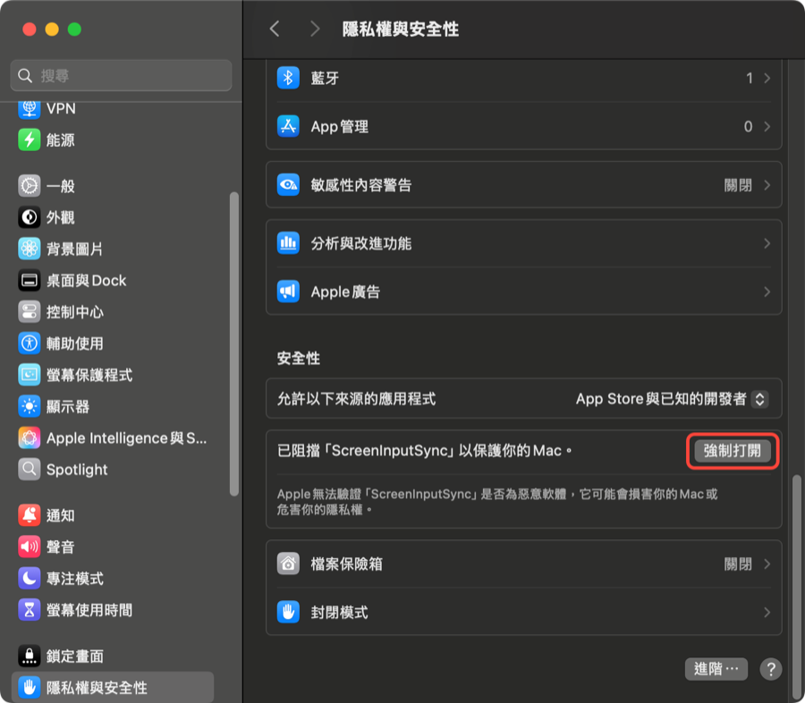
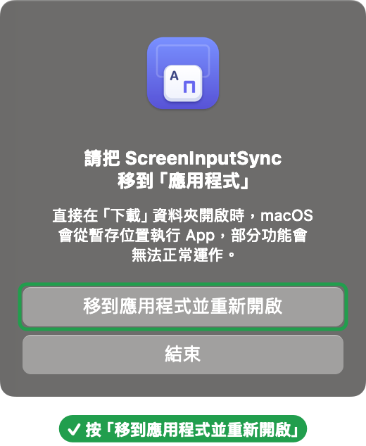

# ScreenInputSync

安裝在**發起連線那台 Mac** 上的選單列小工具。在 Apple 螢幕共享（Screen Sharing）裡按 Caps Lock 或你平常的切換輸入法快捷鍵（例如 `⌃Space`），本機與遠端會一起在 ABC／繁體注音之間切換，而且打字行為與遠端顯示的輸入法一致。其他 App 的 Caps Lock 不受影響。

## 為什麼需要它

用螢幕共享連到另一台 Mac 打中文時，輸入法很容易亂掉：

- **兩邊的輸入法對不上**：在螢幕共享裡按 Caps Lock 只會切換本機，遠端選單列一直停在同一個輸入法。
- **打出來的字和遠端顯示的輸入法不符**：遠端顯示 ABC，大寫英文卻變成全形；遠端顯示注音，卻組不出中文字。
- **全螢幕時看不到本機選單列**：螢幕共享多半開全螢幕，看不到本機目前是哪個輸入法，往往打錯了才發現。

ScreenInputSync 的解法：

- 在螢幕共享裡按 Caps Lock 或你平常的切換快捷鍵，本機和遠端**一起切換**，遠端選單列顯示什麼輸入法，打出來就是什麼。
- Caps Lock 鍵和大寫鎖定狀態不會傳到遠端，所以不會干擾遠端的注音或英文輸入。
- 兩邊萬一對不上，按 ⌘⇧ 後照遠端選單列選一下就能校正，不必離開全螢幕。
- 離開螢幕共享後，本機恢復原本的輸入法，其他 App 的 Caps Lock 照常運作。

## 問題出在哪裡

一句話：**切換只發生在本機，造成兩邊不一致；兩邊一不一致，打字就會出問題。** 細分成三件事：

1. **切換鍵只在本機生效**：Caps Lock 或 `⌃Space` 都會先被本機的 macOS 拿去切換本機的輸入法，遠端收不到切換動作，所以只有本機換了，遠端沒換。
2. **輸入法不一致就會打錯字**：螢幕共享會先用**本機**的輸入法處理按鍵，再送到遠端，所以結果由兩邊一起決定：

   | 本機 | 遠端 | 打字結果 |
   |---|---|---|
   | 注音 | 注音 | 正常組字 |
   | ABC | ABC | 正常半形英文 |
   | ABC | 注音 | 遠端顯示注音，卻直接出英文 |
   | 注音 | ABC | 遠端顯示 ABC，字母卻變成注音符號 |

3. **Caps Lock 的大寫鎖定狀態會傳到遠端**：用 Caps Lock 切換時，大寫鎖定狀態也被送過去，遠端的注音因此變成英文模式，ABC 則可能打出全形。用 `⌃Space` 切換不會有這個問題。

ScreenInputSync 的對應做法：

| 問題 | 做法 |
|---|---|
| 1. 切換鍵只在本機生效 | 在本機攔下切換鍵，本機自己切換，再送 F17 讓遠端也切換 |
| 2. 輸入法不一致就會打錯字 | 這是螢幕共享本身的行為，改不了，所以讓兩邊永遠一致 |
| 3. 大寫鎖定狀態傳到遠端 | Caps Lock 與大寫鎖定狀態都不傳到遠端 |

為什麼用 F17：App 送出的按鍵同樣會先經過本機，如果送 `⌃Space`，本機也會再切換一次。F17 本機沒有用到，大部分鍵盤也沒有這個鍵，只有遠端會對它反應。

## 運作方式

在螢幕共享位於前景時：

- **Caps Lock**：本機明確切換輸入法，並送出 F17 讓遠端切換。Caps Lock 鍵與大寫鎖定狀態都不會傳到遠端（否則遠端注音會被切成英文模式）。
- **你自己的切換快捷鍵**：本機「系統設定 → 鍵盤 → 鍵盤快速鍵 → 輸入方式」裡設定的「選擇上一個／下一個輸入方式」（預設 `⌃Space`，也可以改成 `⌘Space` 等），效果和 Caps Lock 相同。快捷鍵不會傳到遠端，放開修飾鍵後才切換；按住修飾鍵連按兩次等於不切換。修改快捷鍵後，切回螢幕共享就會套用。
- **本機跟隨遠端**：本機輸入法一律維持與遠端相同。例如在其他 App 切過輸入法再回到螢幕共享，本機會自動切回遠端的輸入法；離開螢幕共享後則恢復你原本使用的輸入法。
- **對齊遠端輸入法**：同時按下 ⌘ 和 ⇧ 再放開（中間不按其他鍵），或從選單選「對齊遠端輸入法」，然後依遠端選單列按 `E`（ABC）或 `C`（注音），`Esc` 取消。只改本機，不送 F17。選單與快捷鍵都只在螢幕共享位於前景時有效：從選單點選會提示先切過去，快捷鍵在其他 App 則不作用（`⌘⇧P` 等一般快捷鍵也不受影響）。

本機無法讀取遠端的實際輸入法，只能依切換次數推算。若兩邊變得相反（例如遠端被用滑鼠單獨切換，或 App 剛啟動時推算錯誤），用「對齊遠端輸入法」校正即可。

## 系統需求

- macOS 14 或更新版本
- 本機已啟用 ABC 與「繁體中文－注音」
- 遠端完成下方「遠端 Mac 設定」
- 自行編譯需要 **Xcode 16 或更新版本**（專案使用 Swift 6）

## 安裝

各版本的變更見 [CHANGELOG](CHANGELOG.md)。Intel 與 Apple 晶片的 Mac 都適用。

1. 到 [Releases](https://github.com/Gitgitgitgghub/ScreenInputSync/releases/latest) 下載 `ScreenInputSync-x.y.zip`，點兩下解壓縮，再點兩下 `ScreenInputSync.app`。
2. App 未經 Apple 公證，第一次開啟會出現下面的視窗。按 **「完成」**，**不要按「丟到垃圾桶」**。

   

3. 打開「系統設定 → 隱私權與安全性」，捲到最下面的「安全性」，按 ScreenInputSync 旁的 **「強制打開」**，並輸入密碼或用 Touch ID 確認。

   

   找不到這個按鈕時，再開啟一次 App 讓它被擋下，然後馬上回到這個頁面。

4. 再點兩下 App（若跳出確認視窗，選擇開啟）。App 會提示把自己移到「應用程式」，按 **「移到應用程式並重新開啟」**。不需要自己拖曳。

   

5. 依提示到「輔助使用」允許 ScreenInputSync（見下方「權限」），然後重新開啟 App。選單列出現鍵盤圖示即完成。
6. 遠端 Mac 照下方「遠端 Mac 設定」設定一次。

## 遠端 Mac 設定

遠端（被連線的那台）不需要安裝任何東西，只要在「系統設定 → 鍵盤」設定兩件事：

1. **輸入方式只保留 ABC 與繁體注音**：按「輸入方式」旁的「編輯…」，移除其他輸入方式，確保切換只在這兩者之間來回。

   

2. **設定 F17 快捷鍵**（ScreenInputSync 用 F17 通知遠端切換輸入法）：
   1. 在遠端的「系統設定 → 鍵盤」按「鍵盤快速鍵…」。
   2. 左側選「輸入方式」。
   3. 勾選「選擇上一個輸入方式」。
   4. 在它右邊的快捷鍵上點兩下，進入錄製狀態後按 F17。
      - **鍵盤沒有 F17**（大部分 Mac 鍵盤都沒有）：先在本機裝好並開啟 ScreenInputSync，從本機透過螢幕共享操作遠端，點兩下該欄位後按 **Caps Lock**。ScreenInputSync 會把它轉成 F17 送到遠端，就會錄成 F17。
   5. 右邊顯示「F17」後，按「完成」。

   這裡一定要設 F17，不能設成 `⌃Space`，原因見上方「問題出在哪裡」。遠端想保留 `⌃Space`，可以設在「在輸入選單中選擇下一個方式」，在遠端那台的實體鍵盤上用。

   

   用 Caps Lock 錄製時，本機輸入法會跟著切換一次，但遠端不會。如果之後兩邊輸入法相反，在螢幕共享裡按一次 `⌘⇧` 校正即可。

## 權限

只需要「系統設定 → 隱私權與安全性 → **輔助使用**」（攔截／修改按鍵與送出 F17 都靠它），不需要「輸入監控」。允許後重新開啟 App；選單中也有「開啟輔助使用權限設定」可直接前往。

編譯前請在 Xcode 的 Signing & Capabilities 選擇自己的 Team。專案預設是 ad-hoc 簽署（Sign to Run Locally），每次重新編譯都會被系統當成新 App，必須重新允許權限。

若權限顯示已允許卻仍被要求（簽署身分變更後常見），清除舊紀錄後重新允許：

```sh
tccutil reset Accessibility com.brant.ScreenInputSync
```

## 解除安裝

從選單取消「登入時啟動」並結束 App，然後：

```sh
rm -rf /Applications/ScreenInputSync.app
```

最後可在系統設定中移除它的輔助使用權限。
